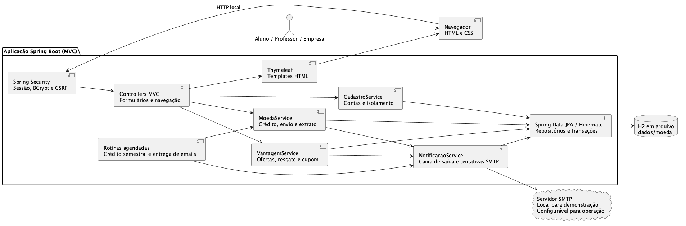
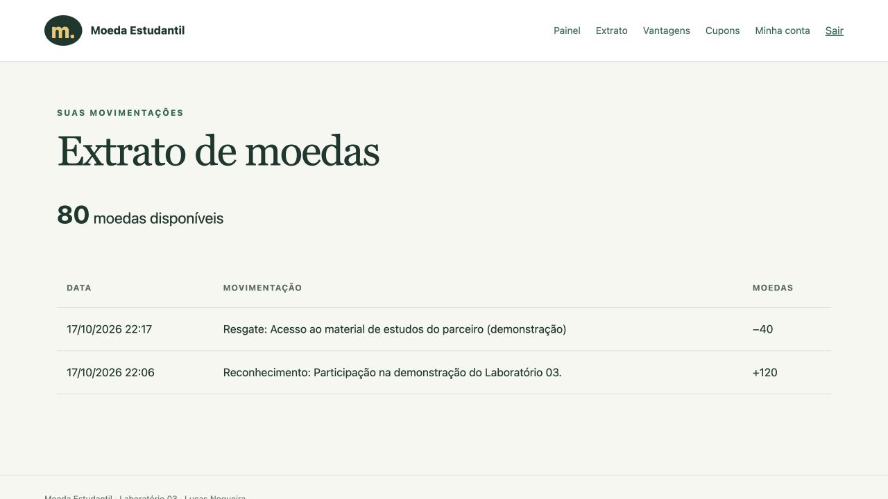
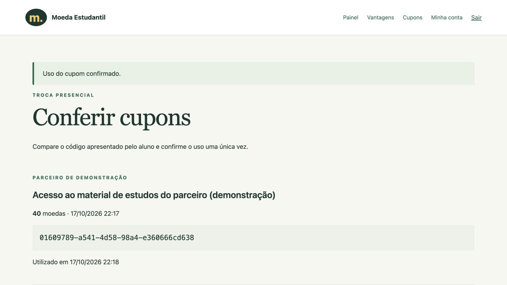

# Sistema de Moeda Estudantil

Release 1 do Laboratório 03 de Desenvolvimento de Software. Professores reconhecem o mérito dos alunos com moedas virtuais, e empresas parceiras oferecem produtos e descontos em troca dessas moedas.

**Autor:** Lucas Nogueira. **Repositório:** [lucasnmc12/lab03-moeda-estudantil](https://github.com/lucasnmc12/lab03-moeda-estudantil), privado e independente dos laboratórios anteriores.

## Status do projeto

Implementação local verificada. Os artefatos das três sprints estão organizados no repositório. Apresentação em aula, ensaio cronometrado, feedback específico do professor e entrega no Canvas dependem do aluno. O professor precisa receber acesso ao repositório privado.

## Índice

[Funcionalidades](#funcionalidades-principais) · [Tecnologias](#tecnologias-utilizadas) · [Arquitetura](#arquitetura) · [Execução](#instalação-e-execução) · [Testes](#testes) · [Apresentações](#apresentações) · [Sprints](#entregas-e-versionamento)

## Links úteis

- [Enunciado](docs/enunciado.md), [roteiros originais](docs/sprints/) e [histórias do usuário](docs/historias-de-usuario.md).
- [Requisitos e critérios de aceite](docs/DEFINE.md), [design técnico](docs/DESIGN.md) e [verificação final](docs/BUILD.md).
- [Revisões e decisões](docs/REVISOES.md) e [contribuições](docs/contribuicoes/lucas-nogueira/).

## Funcionalidades principais

- Cadastro, consulta, edição e remoção de conta própria para aluno e empresa parceira.
- Instituições e professores pré-cadastrados, login por email e senha nos três perfis.
- Crédito de 1.000 moedas por professor a cada semestre, acumulável e sem duplicação no mesmo semestre.
- Envio de moedas com motivo obrigatório, saldo suficiente e notificação por email.
- Extrato privado de professor e aluno com saldo e movimentações.
- Vantagens com descrição, foto PNG/JPEG de até 2 MB e custo positivo.
- Resgate com débito de saldo, cupom de código único e email equivalente ao aluno e ao parceiro.
- Conferência e confirmação única do cupom pelo parceiro dono.

## Tecnologias utilizadas

| Camada | Tecnologia |
|---|---|
| Aplicação | Java 21, Spring Boot 3.5.6, Maven 3.9.11 |
| Interface | Spring MVC, Thymeleaf, HTML e CSS responsivo |
| Acesso | Spring Security, sessão, BCrypt, CSRF |
| Persistência | Spring Data JPA, Hibernate, H2 2.3.232 em arquivo, Flyway |
| Email | Spring Mail/SMTP e caixa de saída transacional |
| Testes | JUnit 5, MockMvc, banco H2 e servidor SMTP local de teste |
| Modelagem | PlantUML |

## Arquitetura

Aplicação MVC com um único servidor: controllers validam formulários e navegação, services aplicam regras e isolamento, repositories acessam o banco e Thymeleaf renderiza as páginas. O banco H2 fica em arquivo e as migrações são versionadas com Flyway.



| Modelo | Fonte editável | Imagem |
|---|---|---|
| Casos de uso | [PlantUML](docs/diagramas/casos-de-uso.puml) | [PNG](docs/diagramas/casos_de_uso.png) |
| Classes | [PlantUML](docs/diagramas/diagrama-de-classes.puml) | [PNG](docs/diagramas/classes_moeda.png) |
| Componentes | [PlantUML](docs/diagramas/diagrama-de-componentes.puml) | [PNG](docs/diagramas/componentes_moeda.png) |
| Entidade-relacionamento | [PlantUML](docs/diagramas/modelo-er.puml) | [PNG](docs/diagramas/modelo_er.png) |

[Mapeamento ORM, concorrência e backup](docs/PERSISTENCIA.md). A exclusão é lógica: a conta perde acesso, e transações/cupons permanecem disponíveis para conferência. Email e CPF identificam a conta e não mudam na tela de edição.

## Instalação e execução

### Pré-requisitos

JDK 21 e internet na primeira execução para baixar Maven/dependências. Python 3.10+ apenas para o capturador SMTP de demonstração. Não é necessário instalar um servidor de banco separado. O wrapper reconhece o JDK 21 do Homebrew em `/opt/homebrew/opt/openjdk@21`. Em outros ambientes, aponte `JAVA_HOME` para seu JDK caso o Java não esteja no PATH.

```bash
git clone https://github.com/lucasnmc12/lab03-moeda-estudantil.git
cd lab03-moeda-estudantil
./mvnw spring-boot:run -Dspring-boot.run.profiles=demo
```

Abra [localhost:8080](http://localhost:8080). O perfil `demo` inclui uma instituição fictícia e o professor `professor@demo.local`, senha `Professor123!`. Alunos e empresas criam suas próprias contas pela interface. Use somente dados fictícios na demonstração.

O perfil padrão começa sem dados demonstrativos. Instituições e professores devem ser provisionados pelo responsável pela instalação, a partir da lista de parceria. A interface não permite criar um professor arbitrariamente.

### Emails na demonstração

Em outro terminal, na raiz do projeto:

```bash
python3 scripts/smtp_local.py
```

O SMTP escuta em `127.0.0.1:1025`. A [caixa local](http://localhost:8025) mostra as mensagens capturadas em `dados/emails/`. O script não encaminha emails à internet. Se estiver desligado, as notificações permanecem no banco e a aplicação tenta novamente a cada 15 segundos.

### Variáveis de ambiente

| Variável | Padrão / finalidade |
|---|---|
| `DB_URL` | `jdbc:h2:file:./dados/moeda` |
| `DB_USER`, `DB_PASSWORD` | `sa` e senha vazia, para demonstração local |
| `SMTP_HOST`, `SMTP_PORT` | `127.0.0.1`, `1025` |
| `SMTP_USER`, `SMTP_PASSWORD` | Credenciais do provedor quando necessário |
| `SMTP_AUTH`, `SMTP_TLS` | `false` localmente; configurar conforme o provedor |
| `SMTP_FROM` | `moeda@localhost` na demonstração |
| `JOBS_ATIVOS` | `true`, rotinas de crédito e email |
| `SERVER_PORT` | `8080` |

Exportar variáveis no terminal ou configurar o ambiente do processo. Arquivos `.env` não são carregados automaticamente pelo Spring. Não versionar credenciais.

### Banco, build e operação

Os dados sobrevivem ao reinício em `dados/moeda.mv.db`. Flyway aplica a migração V1 na primeira execução e Hibernate valida o schema. Antes de fazer backup, pare a aplicação e copie a pasta `dados/`. Não abra duas instâncias contra o mesmo arquivo.

```bash
./mvnw clean verify
java -jar target/moeda-estudantil-0.0.1-SNAPSHOT.jar --spring.profiles.active=demo
```

Para publicação real, configurar HTTPS, banco/backup adequados e SMTP do provedor. Não houve deploy nem teste de entrega a provedores externos nesta execução.

## Estrutura de pastas

```text
docs/                       enunciado, sprints, modelos, decisões e apresentações
scripts/smtp_local.py       capturador local de email e caixa de demonstração
src/main/java/.../moeda/
  config/                   autenticação, dados demonstrativos e rotinas
  controller/               rotas MVC e navegação
  dto/                      formulários com validação
  modelo/                   entidades e regras de saldo/cupom
  repositorio/              acesso JPA e consultas com bloqueio
  servico/                  casos de aplicação e transações
src/main/resources/
  db/migration/             schema versionado
  templates/                páginas Thymeleaf
  static/css/               estilos
src/test/                   testes de integração, regras e persistência
```

## Demonstração

Imagens de uma execução local com dados fictícios. O professor enviou 120 moedas, a aluna resgatou 40 e o parceiro confirmou o cupom.

| Extrato do aluno | Cupom conferido pelo parceiro |
|---|---|
|  |  |

## Testes

```bash
./mvnw clean verify
```

25 testes cobrem CRUDs completos, entradas inválidas, duplicidade, login dos três perfis, acesso cruzado, conta desativada, CSRF, saldo, créditos semestrais, envios/resgates concorrentes, cupom único, migração, persistência em arquivo e entrega SMTP local. Os testes usam dados e dependências locais isolados. [Resultados e limites](docs/BUILD.md).

## Apresentações

| Material | Editável | PDF |
|---|---|---|
| Arquitetura e persistência | [PowerPoint](docs/apresentacao/arquitetura.pptx) | [PDF](docs/apresentacao/arquitetura.pdf) |
| Tutorial de tecnologias | [PowerPoint](docs/apresentacao/tutorial-tecnologias.pptx) | [PDF](docs/apresentacao/tutorial-tecnologias.pdf) |

[Roteiro de vinte minutos, preparação e perguntas](docs/tutorial.md). As notas dos slides orientam a apresentação. O ensaio com cronômetro permanece a cargo do aluno.

## Entregas e versionamento

- **Sprint 1:** casos de uso, histórias, classes e componentes. Tag `sprint1`.
- **Sprint 2:** ER, ORM e CRUDs iniciais com interface. Tag `sprint2`, [registro](docs/SPRINT2.md).
- **Sprint 3:** interface final, moedas/vantagens, slides e tutorial. Tag `sprint3`, [comparação entre modelos e implementação](docs/SPRINT3.md).

Os horários dos commits são reais e pertencem a esta execução. Não comprovam presença nem progresso durante as aulas anteriores. Nenhuma correção específica deste laboratório foi atribuída ao professor sem registro fornecido.

## Documentações e créditos

README adaptado do [template indicado pela disciplina](https://github.com/joaopauloaramuni/laboratorio-de-desenvolvimento-de-software/blob/main/TEMPLATES/template_README.md), com as seções aplicáveis ao projeto. [Spring](https://docs.spring.io/spring-boot/3.5/), [Thymeleaf](https://www.thymeleaf.org/documentation.html), [H2](https://h2database.com/html/main.html) e [PlantUML](https://plantuml.com/).

Lucas Nogueira é o único integrante informado. O Codex, da OpenAI, apoiou modelagem, implementação, testes e preparação dos materiais. Os registros de contribuição descrevem esse apoio e as pendências da apresentação.
