# Slides da apresentação final

Dez slides renderizados da apresentação editável no Spaces. A [versão textual e as notas de fala](../APRESENTACAO.md) permitem consultar o material inteiro no repositório. Ensaio e apresentação humana ainda pendentes.

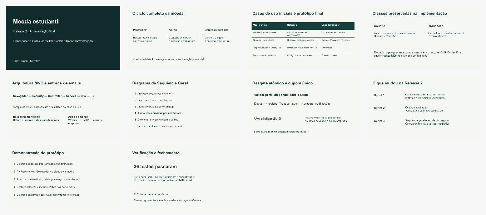

## 1. Moeda estudantil

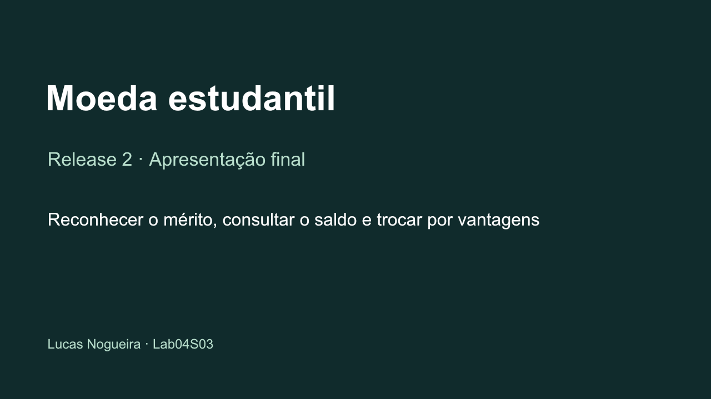

## 2. O ciclo completo da moeda

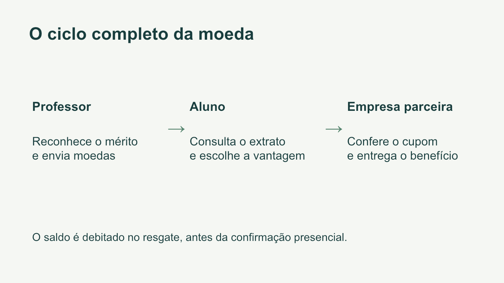

## 3. Casos de uso iniciais e protótipo final

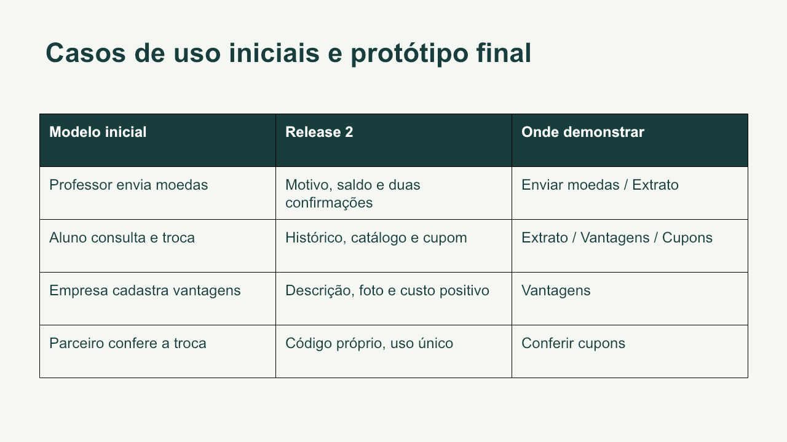

## 4. Classes preservadas na implementação

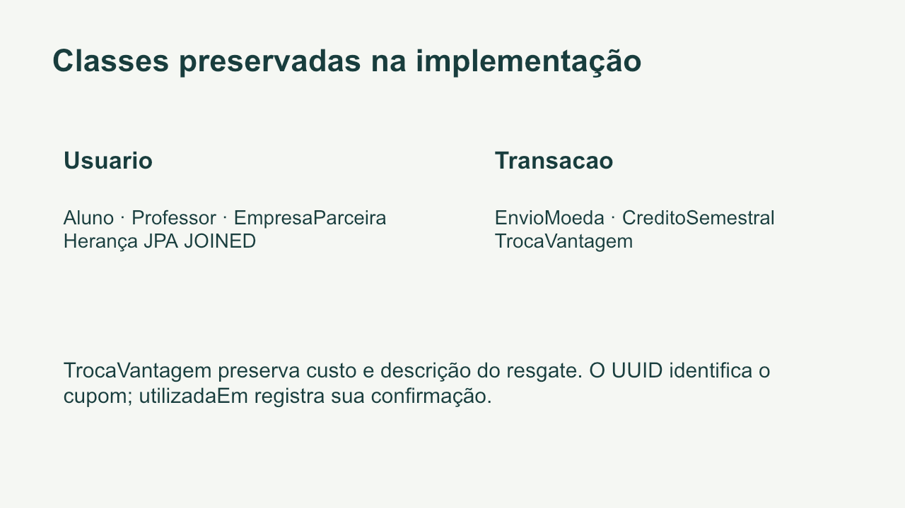

## 5. Arquitetura MVC e entrega de emails

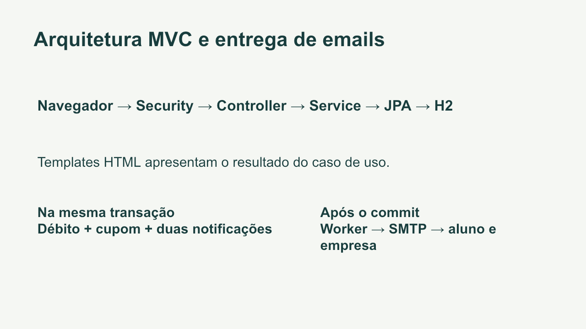

## 6. Diagrama de Sequência Geral

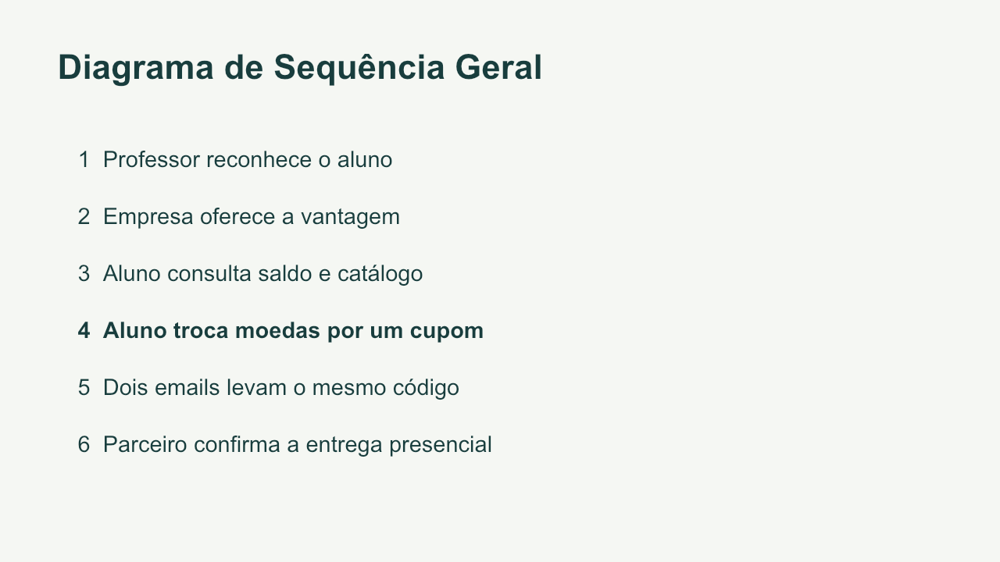

## 7. Resgate atômico e cupom único

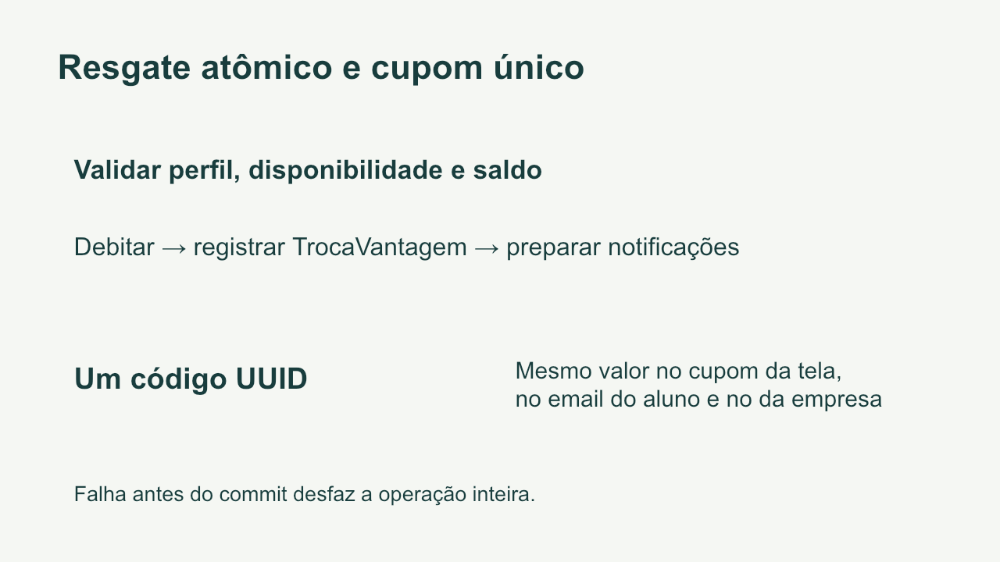

## 8. O que mudou na Release 2

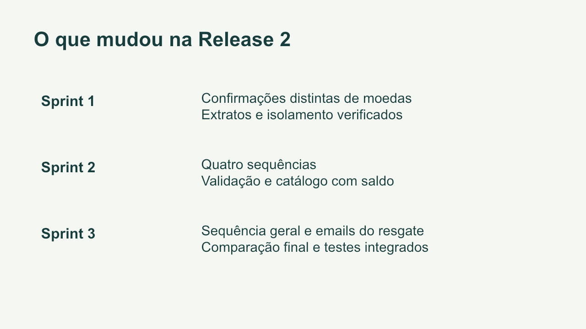

## 9. Demonstração do protótipo

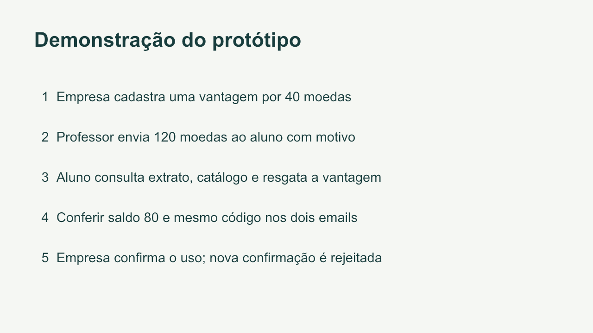

## 10. Verificação e fechamento

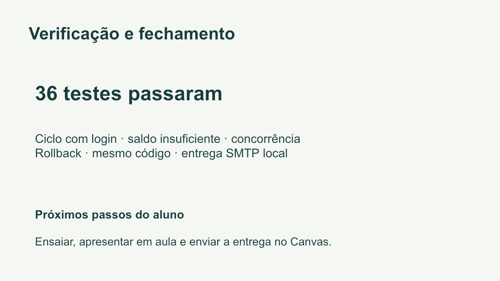
