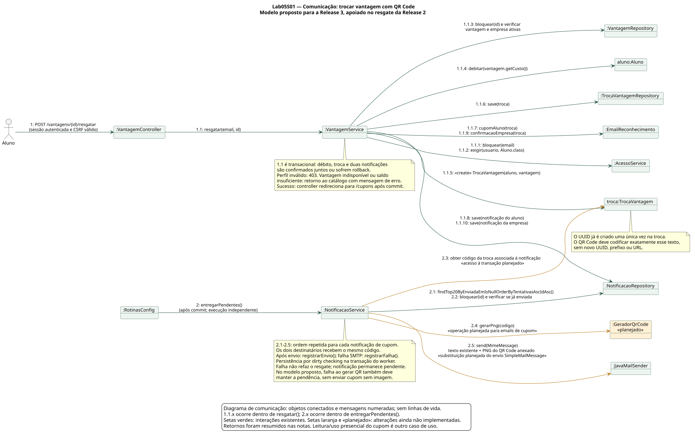

# Lab05S01 — Release 3

## Entrega desta etapa

Diagrama de Comunicação do caso de uso **Trocar Vantagem com QR Code**, primeiro item da sprint. O modelo parte da Release 2 integrada à `main` no commit `cde93fe` e propõe a inclusão do QR Code sem alterar o comportamento da aplicação nesta entrega.

- [Fonte PlantUML](diagramas/comunicacao-trocar-vantagem-qr.puml)
- [Imagem SVG](diagramas/comunicacao-trocar-vantagem-qr.svg)
- [Imagem PNG](diagramas/comunicacao-trocar-vantagem-qr.png)
- [Contribuições de Lucas](../contribuicoes/lucas-nogueira/sprint1.md)



## Como explicar o diagrama

Os objetos são ligados por setas, e a numeração indica a ordem das mensagens. Diferentemente de um diagrama de sequência, a posição vertical não representa o tempo e não há linhas de vida. As mensagens `1.1.1` a `1.1.10` acontecem dentro da chamada `1.1: resgatar(email, id)`.

1. O aluno autenticado pede o resgate. O controller chama `VantagemService`, que verifica o perfil, bloqueia os registros envolvidos e valida disponibilidade e saldo.
2. O serviço debita o saldo, cria a troca com um único UUID, salva a troca, renderiza os dois textos e grava as duas notificações. Essas alterações pertencem à mesma transação. Só depois do commit o controller retorna o redirecionamento para os cupons.
3. Em outra execução, `RotinasConfig` aciona `NotificacaoService.entregarPendentes()`. O worker consulta e bloqueia as notificações pendentes. A numeração reinicia em `2`, pois essa entrega não é uma chamada interna do resgate.
4. Na evolução proposta, o worker obtém o código persistido da troca, gera um PNG e envia o texto com o QR Code anexado. O processo se repete para a notificação da empresa usando exatamente o mesmo código. Notificações de reconhecimento de moedas continuam fora dessa geração de QR.
5. O worker registra sucesso ou falha. Uma indisponibilidade de SMTP não refaz o débito nem cria outro cupom. O envio é assíncrono e pode sofrer novas tentativas; não se promete entrega de email exatamente uma vez.

As setas laranja e a marca `«planejado»` identificam a evolução da Release 3. Elas não representam código já entregue.

## Correspondência com a implementação

| Participante / mensagem | Referência atual e situação |
|---|---|
| `VantagemController.resgatar` | [Controller](../../../src/main/java/br/edu/pucminas/moeda/controller/VantagemController.java): POST com redirecionamento e tratamento de erro de negócio. |
| `VantagemService.resgatar` | [Serviço](../../../src/main/java/br/edu/pucminas/moeda/servico/VantagemService.java): transação, autorização, disponibilidade, débito, troca e duas notificações. |
| `TrocaVantagem` | [Entidade](../../../src/main/java/br/edu/pucminas/moeda/modelo/TrocaVantagem.java): UUID único e dados da vantagem preservados. |
| `EmailReconhecimento` | [Templates](../../../src/main/java/br/edu/pucminas/moeda/servico/EmailReconhecimento.java): `cupomAluno` e `confirmacaoEmpresa` já existem. |
| `RotinasConfig` / `NotificacaoService` | [Agendamento](../../../src/main/java/br/edu/pucminas/moeda/config/RotinasConfig.java) e [worker](../../../src/main/java/br/edu/pucminas/moeda/servico/NotificacaoService.java): entrega pendente a cada 15 segundos, com bloqueio, controle de tentativas e SMTP. |
| Acesso ao código da troca pelo worker | Planejado: `Notificacao` já possui associação à transação, mas ainda não expõe esse acesso ao worker. Será necessário distinguir `TrocaVantagem` dos demais tipos de transação. |
| `GeradorQrCode.gerarPng(codigo)` | Novo participante e operação propostos; ainda não existem na aplicação. |
| `JavaMailSender.send(MimeMessage)` | Evolução planejada: o envio atual usa `SimpleMailMessage`, sem anexos. A imagem deve ser reconstruída a partir do código persistido em cada tentativa, sem depender de arquivo temporário. |

O QR Code representará **somente o código textual já existente**, sem gerar outro identificador. A proposta de gerá-lo na entrega SMTP mantém a operação de resgate separada da preparação do anexo. A implementação futura deve tratar falhas de geração como pendência e preservar os emails sem QR que pertencem a outros fluxos.

## Fluxos de erro considerados

- Perfil diferente de aluno: acesso negado (403), antes do débito.
- Vantagem indisponível ou saldo insuficiente: mensagem no catálogo, sem troca nem notificações.
- Falha na preparação dos textos ou na persistência durante o resgate: rollback de toda a transação.
- Falha SMTP: notificação permanece pendente; não há novo resgate.
- Falha de geração do QR Code: comportamento proposto é manter pendência e não enviar um cupom sem imagem; ainda precisa ser implementado e testado.

## Verificação do artefato

O PlantUML foi validado e renderizado localmente em SVG e PNG, com inspeção visual da imagem. A correspondência das mensagens existentes foi conferida contra o código e o [diagrama de sequência do resgate da Release 2](../../lab04/sprint3/diagramas/trocar-vantagem.puml). Não houve alteração no código Java, banco, configuração SMTP ou infraestrutura.

Para reproduzir com PlantUML e Graphviz instalados, a partir da raiz:

```sh
plantuml -checkonly docs/lab05/sprint1/diagramas/comunicacao-trocar-vantagem-qr.puml
plantuml -tsvg docs/lab05/sprint1/diagramas/comunicacao-trocar-vantagem-qr.puml
plantuml -tpng docs/lab05/sprint1/diagramas/comunicacao-trocar-vantagem-qr.puml
```

## Situação dos critérios

| Critério do roteiro | Peso | Situação desta etapa |
|---|---|---|
| Diagrama de Comunicação | 1,0 | Artefato preparado e verificado; avaliação cabe ao professor. |
| Diagrama de Implantação | 1,0 | Pendente. |
| Cupons por email com QR Code único | 2,0 | Modelado; implementação e testes pendentes. |
| Implantação em nuvem | 2,0 | Pendente; provedor e destino ainda precisam ser definidos. |
| Histórico de commits durante a aula | 4,0 | Depende dos horários reais de trabalho; o diagrama não comprova presença nem garante pontuação. |

Prazo informado no roteiro: **30/11/2026 às 23h59**. Esta entrega cobre somente o primeiro item autorizado. Não houve implantação nem envio de email externo.
