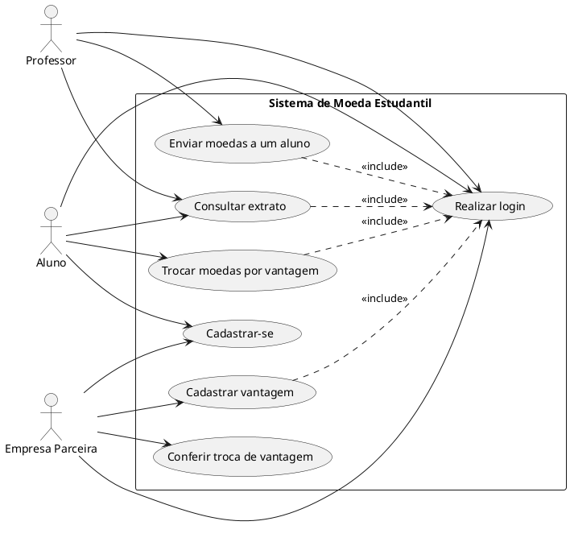
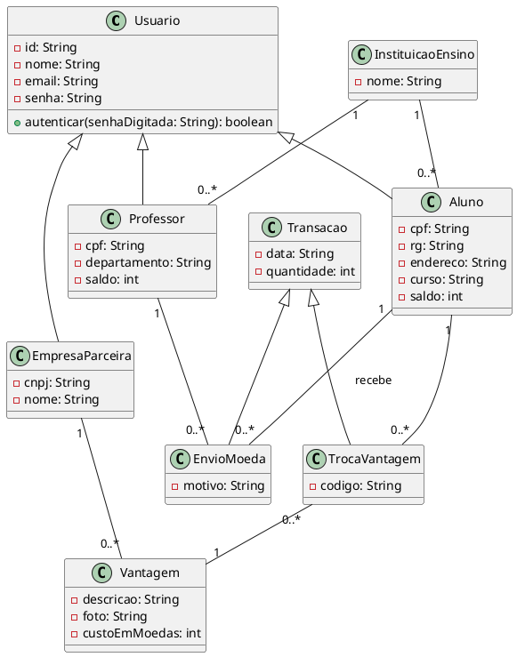
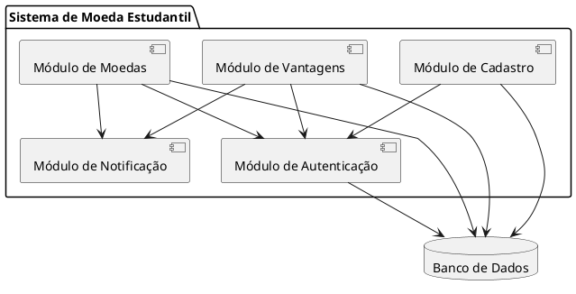

- Vencimento 5 Out por 23:59
- Pontos 6
Sistema de Moeda Estudantil (Release 1)
Este roteiro complementa o enunciado do Laboratório 03 e a Rubrica Lab03S01. Consulte o enunciado para os critérios completos de avaliação e prazos.
Nota de transparência sobre uso de IA: em conformidade com a política de uso responsável de Inteligência Artificial da disciplina, informa-se que este roteiro foi produzido com apoio da ferramenta Claude, da empresa Anthropic, utilizada na geração e revisão de texto e dos exemplos de diagrama e código. O conteúdo foi revisado pelo professor antes da disponibilização aos alunos.
Nesta sprint, o grupo deve modelar o sistema a partir da descrição fornecida no enunciado, produzindo o Diagrama de Casos de Uso, as Histórias do Usuário, o Diagrama de Classes e o Diagrama de Componentes. Este laboratório dá ao grupo autonomia para escolher a ferramenta de modelagem e a forma de organizar o trabalho internamente; o que é avaliado é o resultado e a evidência de que ele foi construído ao longo da aula.
A rubrica desta sprint distribui os 6,0 pontos assim:
- Grupo formado e repositório GitHub criado.
- Leitura atenta da descrição do sistema no enunciado do Laboratório 03.
- Ferramenta de modelagem UML utilizando PlantUML.
- PlantUML Online: [https://plantuml.online/Links to an external site.](https://plantuml.online/)
- PlantUML, site oficial: [https://plantuml.com/Links to an external site.](https://plantuml.com/)
- PlantText: [https://www.planttext.com/Links to an external site.](https://www.planttext.com/)
 
Veja a seção de conceitos-chave do roteiro de modelagem do Laboratório 01 para uma explicação detalhada de ator, caso de uso, <<include>>/<<extend>> e do formato de história de usuário (Como <ator>, eu quero <ação>, para que <benefício>). As mesmas definições valem aqui.
Representa as classes do sistema, seus atributos, métodos e relacionamentos (associação, agregação, composição, herança), com a notação de visibilidade + (público), - (privado) e # (protegido).
Diferente do diagrama de classes, que é detalhado e granular, o diagrama de componentes mostra uma visão de mais alto nível: os módulos (componentes) que compõem o sistema, o que cada um oferece e de que outros módulos ele depende. Um componente costuma agrupar várias classes relacionadas (por exemplo, um "Módulo de Autenticação" reúne as classes responsáveis por login e validação de senha).
Use o template de README.md indicado no enunciado do Laboratório 03. Marque a opção de gerar um .gitignore para a linguagem/framework escolhido pelo grupo.
Em Settings > Collaborators, adicione todos os integrantes do grupo e o professor, se o repositório for privado.
[https://github.com/joaopauloaramuni/laboratorio-de-desenvolvimento-de-software/blob/main/TEMPLATES/template_README.mdLinks to an external site.](https://github.com/joaopauloaramuni/laboratorio-de-desenvolvimento-de-software/blob/main/TEMPLATES/template_README.md)
Releia a descrição do sistema no enunciado. Os atores principais são:
- Aluno: se cadastra, recebe moedas, consulta extrato, troca moedas por vantagens.
- Professor: já pré-cadastrado, envia moedas a alunos, consulta extrato.
- Empresa Parceira: se cadastra, cadastra vantagens, confere trocas.
Listem, a partir da descrição, as ações de cada ator. Exemplos para este sistema:
- Realizar login
- Cadastrar-se (aluno ou empresa parceira)
- Enviar moedas a um aluno
- Consultar extrato
- Trocar moedas por vantagem
- Cadastrar vantagem
- Conferir troca de vantagem
Exemplo em PlantUML (opcional, adapte para a ferramenta escolhida pelo grupo):
plantuml

Para cada caso de uso, escreva uma história no arquivo docs/historias-de-usuario.md.
markdown
```markdown
## Histórias do Usuário

### HU01, Enviar moedas a um aluno
Como professor, eu quero enviar moedas a um aluno, informando o motivo,
para reconhecer seu bom comportamento ou participacao em aula.

### HU02, Trocar moedas por vantagem
Como aluno, eu quero trocar minhas moedas por uma vantagem cadastrada,
para obter descontos ou produtos oferecidos pelas empresas parceiras.

### HU03, Conferir troca de vantagem
Como empresa parceira, eu quero conferir o codigo do cupom apresentado
pelo aluno, para validar a troca presencial da vantagem.
```
Releiam os casos de uso e as histórias, sublinhando os substantivos relevantes. Candidatos naturais para este sistema: Usuario, Aluno, Professor, EmpresaParceira, InstituicaoEnsino, Vantagem, Transacao (com as especializações EnvioMoeda e TrocaVantagem).
plantuml

Nota de modelagem: Transacao foi modelada como uma classe abstrata com duas especializações, EnvioMoeda (professor para aluno) e TrocaVantagem (aluno por uma vantagem), porque são operações com regras e participantes diferentes, mas que compartilham data e quantidade. O grupo pode optar por uma modelagem diferente, desde que justificada.
Agrupem as classes em módulos coesos. Sugestão inicial:
- Módulo de Autenticação: login e validação de senha de todos os perfis.
- Módulo de Cadastro: cadastro de aluno, professor (via lista da instituição) e empresa parceira.
- Módulo de Moedas: envio de moedas, consulta de extrato, regras de saldo.
- Módulo de Vantagens: cadastro de vantagens, troca e geração de cupom.
- Módulo de Notificação: envio de e-mails (recebimento de moeda, cupom de troca).
plantuml

Use o template de README.md indicado no enunciado, incluindo a descrição do sistema, os diagramas produzidos e a URL do repositório.
bash
```bash
git add docs/diagramas/casos-de-uso.*
git commit -m "docs: adiciona diagrama de casos de uso"

git add docs/historias-de-usuario.md
git commit -m "docs: adiciona historias do usuario"

git add docs/diagramas/diagrama-de-classes.*
git commit -m "docs: adiciona diagrama de classes"

git add docs/diagramas/diagrama-de-componentes.*
git commit -m "docs: adiciona diagrama de componentes"

git add README.md
git commit -m "docs: atualiza README com base no template"

git push origin main
```
Confira o checklist da seção 6 e garanta que o grupo consegue explicar as decisões de modelagem tomadas, especialmente a divisão em componentes e as especializações do diagrama de classes.
Este é o critério de maior peso individual da rubrica. Ele avalia o histórico do repositório GitHub do grupo, verificando se os commits foram realmente feitos durante o horário da aula (segundas-feiras, das 10:40 às 12:20), e não concentrados fora desse período.
- Façam commits pequenos e frequentes ao longo da aula, um a cada etapa concluída (por exemplo, ao terminar cada diagrama), em vez de um único commit no fim do encontro.
- Usem mensagens claras, descrevendo o que foi feito (docs: adiciona diagrama de casos de uso, e não apenas atualização).
- Deem git push regularmente durante a aula, não só ao final.
- Trabalho feito fora do horário de aula é normal e esperado em um projeto real, mas uma parte relevante do progresso precisa ficar registrada dentro do horário de aula, pois é isso que compõe os 40% da nota.
- Confundir diagrama de componentes com diagrama de classes. O primeiro é uma visão de módulos e dependências; o segundo é o detalhe de atributos e métodos.
- Modelar Transacao sem diferenciar envio de moeda e troca por vantagem. São operações com participantes e regras diferentes; vale a pena representá-las de forma distinta, como no exemplo do Passo 9.
- Histórias de usuário genéricas demais. Evite "Como aluno, eu quero usar o sistema"; prefira sempre um benefício específico.
- Concentrar todos os commits em um único horário fora da aula. Isso reduz diretamente a nota do critério de commits, mesmo que o conteúdo entregue esteja completo.

